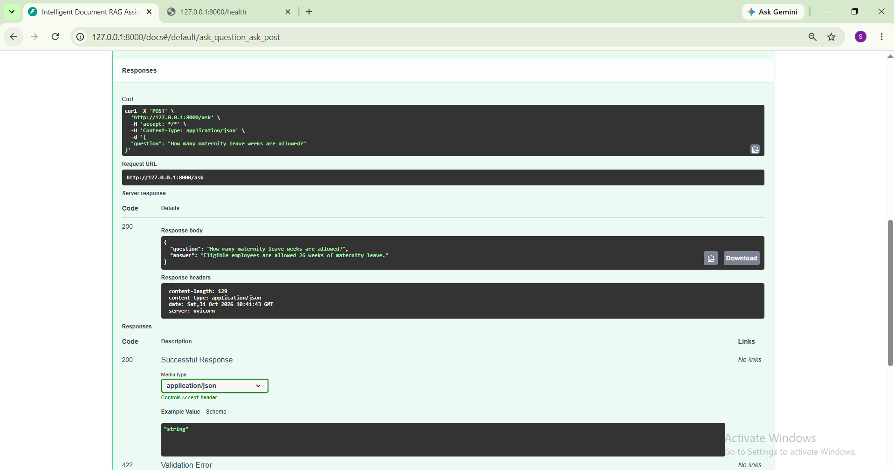
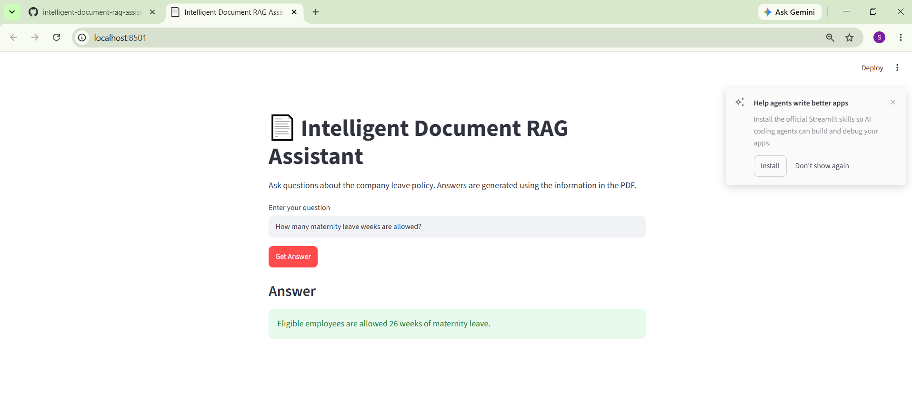
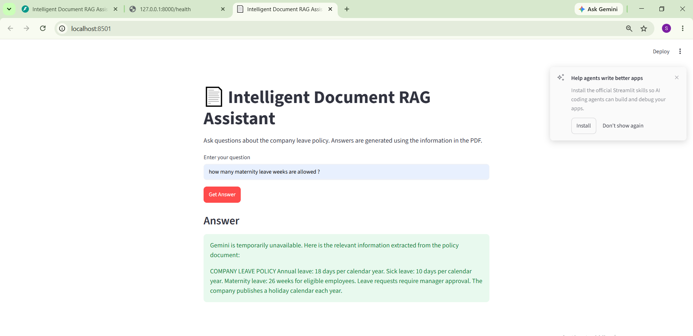

# 📄 Intelligent Document RAG Assistant

**Ask Questions. Retrieve Knowledge. Get Context-Grounded Answers.**

An AI-powered document question-answering system built using Retrieval-Augmented Generation (RAG), FAISS, Google Gemini, Streamlit and FastAPI.

## 🚀 Project Overview

Intelligent Document RAG Assistant enables users to interact with company leave-policy documents through natural language questions.

Instead of manually searching through PDF documents, users can ask questions and retrieve relevant information through a document-based AI assistant.

The system uses semantic search to retrieve relevant document chunks and Google's Gemini API to generate context-grounded answers.

### ✨ Key Features

- 📑 **PDF Processing:** Extracts text from PDF documents using PyPDF.
- ✂️ **Text Chunking:** Splits extracted text into manageable chunks.
- 🧠 **Semantic Embeddings:** Generates vector representations using Sentence Transformers.
- 🔍 **Similarity Search:** Uses FAISS for efficient vector similarity search.
- 🤖 **AI-Powered Responses:** Uses Google Gemini to generate context-grounded answers.
- 🛡️ **Fallback Handling:** Returns retrieved document context when Gemini is unavailable.
- 🌐 **REST API:** Exposes question-answering functionality through FastAPI.
- 📊 **Interactive UI:** Provides a user-friendly Streamlit interface.
- 📝 **Logging:** Maintains application logs for monitoring and debugging.

## 🎯 Problem Statement

Organizations often maintain important information, such as employee leave policies, in PDF documents.

Finding specific information manually can be time-consuming. This project addresses that challenge by allowing users to ask natural language questions and retrieve relevant information directly from documents.

### Project Objectives

- Simplify information retrieval from PDF documents.
- Implement an end-to-end RAG pipeline.
- Generate semantic embeddings for document content.
- Store and search vector representations using FAISS.
- Retrieve relevant context before answer generation.
- Generate context-grounded responses using Gemini.
- Handle missing information and temporary LLM failures gracefully.

## 🏗️ System Architecture

### RAG Pipeline

```text
PDF Document
     |
     ▼
Text Extraction
     |
     ▼
Text Chunking
     |
     ▼
Embedding Generation
     |
     ▼
FAISS Vector Index
     |
     ▼
Relevant Context Retrieval
     |
     ▼
Gemini LLM
     |
     ▼
Generated Answer
```

### Application Architecture

- **Streamlit:** Interactive frontend for submitting questions.
- **FastAPI:** REST API for document question answering.
- **RAG Pipeline:** Coordinates retrieval and answer generation.
- **Document Resources:** Loads and prepares document resources with caching.

### Architecture Components

| Component | Responsibility |
|---|---|
| PDF Loader | Extracts text from PDF documents |
| Chunker | Splits extracted text into smaller chunks |
| Embedder | Generates semantic embeddings |
| FAISS | Stores and searches vector representations |
| Retriever | Retrieves relevant document chunks |
| Gemini | Generates context-grounded responses |
| RAG Pipeline | Coordinates the complete workflow |
| Streamlit | Provides the interactive user interface |
| FastAPI | Exposes REST API endpoints |
| Logger | Records application events and errors |

## 🛠️ Technology Stack

| Category | Technologies |
|---|---|
| Programming Language | Python |
| PDF Processing | PyPDF |
| Embedding Model | Sentence Transformers (`all-MiniLM-L6-v2`) |
| Vector Search | FAISS |
| Large Language Model | Google Gemini API |
| Frontend | Streamlit |
| Backend API | FastAPI |
| API Server | Uvicorn |
| Configuration | Python Dotenv |
| Logging | Python Logging Module |

## 📁 Project Structure

```text
intelligent-document-rag-assistant/
│
├── api/
│   └── main.py
│
├── app/
│   └── streamlit_app.py
│
├── data/
│   └── documents/
│       └── leave_policy.pdf
│
├── images/
│   ├── fastapi_api_response.png
│   └── streamlit_fallback_response.png
│
├── src/
│   ├── embeddings/
│   │   └── embedder.py
│   ├── ingestion/
│   │   └── pdf_loader.py
│   ├── llm/
│   │   └── generator.py
│   ├── processing/
│   │   └── chunker.py
│   ├── retrieval/
│   │   └── retriever.py
│   ├── utils/
│   │   └── logger.py
│   ├── vectorstore/
│   │   └── vector_db.py
│   ├── document_resources.py
│   └── rag_pipeline.py
│
├── .gitignore
├── requirements.txt
├── README.md
└── LICENSE
```

## ⚙️ Installation and Setup

### 1. Clone the Repository

```bash
git clone https://github.com/Shalini-Nanda-ds/intelligent-document-rag-assistant.git

cd intelligent-document-rag-assistant
```

### 2. Create a Virtual Environment

```bash
python -m venv .venv
```

Activate it on Windows:

```cmd
.venv\Scripts\activate
```

### 3. Install Dependencies

```bash
pip install -r requirements.txt
```

### 4. Configure Environment Variables

Create a `.env` file in the project root:

```env
GEMINI_API_KEY=your_gemini_api_key
```

Replace the placeholder with your Gemini API key.

**Important:** Never upload your `.env` file or expose your API key publicly.

## ▶️ Running the Application

### Streamlit Interface

```bash
python -m streamlit run app/streamlit_app.py
```

Open:

`http://localhost:8501`

### FastAPI Server

```bash
uvicorn api.main:app --reload
```

Open the interactive API documentation:

`http://127.0.0.1:8000/docs`

### Available API Endpoints

| Method | Endpoint | Description |
|---|---|---|
| GET | `/` | API welcome message |
| GET | `/health` | Health check |
| POST | `/ask` | Submit a document-related question |

Example request:

```json
{
  "question": "How many maternity leave weeks are allowed?"
}
```

Example response:

```json
{
  "question": "How many maternity leave weeks are allowed?",
  "answer": "Eligible employees are allowed 26 weeks of maternity leave."
}
```

## 📸 Application Screenshots

### 1. FastAPI – Successful API Response


### 2. Streamlit – Successful Gemini Response


### 3. Streamlit – Fallback Response


## ⚠️ Current Limitations

- The current implementation has been tested with a small sample leave-policy PDF.
- Large-document performance and scalability have not yet been benchmarked.
- Gemini API availability and response time depend on the external service.
- When Gemini is unavailable, the application returns retrieved document context instead of an AI-generated answer.

## 🔮 Future Improvements

- Test with larger and multiple PDF documents.
- Add support for multiple document uploads.
- Improve document retrieval and evaluation.
- Add automated unit and integration tests.
- Explore deployment options for public access.

## 👩‍💻 Author

**Shalini Nanda**

[GitHub Profile](https://github.com/Shalini-Nanda-ds)

## 📄 License

This project is licensed under the MIT License. See the [LICENSE](LICENSE) file for details.